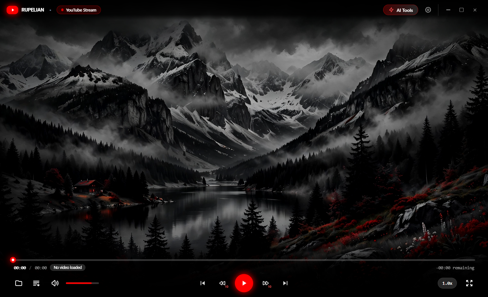

# Rupelian Player

**Watch. Understand. Learn.**

A modern desktop video player built for language learners. Watch local videos or YouTube, explore interactive subtitles, save useful vocabulary, and work through difficult language with an AI tutor without leaving the player.

[](#development)
[](#project-status)



## Built for active watching

- **Native video playback.** Hardware-accelerated local playback through libmpv, precise seeking, speed controls, multiple audio tracks, fullscreen, and timeline previews.
- **YouTube in the player.** Quality selection, captions, alternate audio, and coordinated playback behind the desktop interface. Public playback requires no browser session; restricted videos can use an explicitly connected browser session.
- **Interactive subtitles.** Load external subtitles or text tracks embedded in local videos. Select words or phrases, synchronize captions, and show two subtitle tracks together.
- **Context-aware AI translation.** Translate a line, a complete subtitle track, or upcoming dialogue. Saved translation progress can be resumed later.
- **A personal vocabulary library.** Keep words and phrases with their source sentence, translation, media reference, and learning status.
- **An AI tutor in context.** Ask follow-up questions about the language in the scene using your configured provider and model.
- **A focused desktop experience.** Frameless controls, editable shortcuts, playback resume, subtitle appearance settings, and a lightweight native loading window.

The public product name is **Rupelian Player**. The brand, logo, project, and executable use **Rupelian** / `rupelian`.

## Project status

Rupelian is in active development. **Windows 10/11 x64** is the supported development and validation target. This repository contains the source project; a stable, signed global release has not been published yet. Do not treat historical portable outputs or local validation reports as a current release.

YouTube availability depends on network access, upstream delivery changes, and access restrictions. AI features require a configured provider; external providers may have their own usage costs. Image-based subtitles are identified but do not yet support OCR-based learning text.

## Development

Install Node.js 24 LTS, the stable Rust MSVC toolchain, Visual Studio Build Tools with **Desktop development with C++** and a Windows SDK, and Microsoft Edge WebView2 Runtime.

```powershell
git clone https://github.com/hamides-dev/rupelian.git
cd rupelian
npm ci
npm run setup:media
npm run tauri dev
```

The media setup downloads pinned Windows x64 dependencies from their upstream projects and verifies their SHA256 hashes. Executables, DLLs, build outputs, browser profiles, and personal data are not committed. Verify an existing setup with `npm run check:media`.

For a frontend-only preview, run `npm run dev`. Native playback and desktop services require Tauri. Rust's disposable build cache defaults to `%LOCALAPPDATA%\Rupelian\cargo-target`.

## Validation

```powershell
npm run check
npm run cargo:check -- --locked
npm run cargo:test -- --locked
```

A Windows GitHub Actions workflow is prepared and awaiting authorization to publish it. It is intended to run source checks and Rust checks/tests. Actual playback, GPU composition, browser connection, and desktop interaction need the focused smoke tests documented in [AGENTS.md](AGENTS.md); unit tests alone do not validate those behaviors.

To expose the development WebView to those tests:

```powershell
$env:WEBVIEW2_ADDITIONAL_BROWSER_ARGUMENTS = '--remote-debugging-port=9223'
npm run tauri dev
```

Use an isolated `RUPELIAN_DATA_DIR` for tests that write settings or credentials. Never automate tests against personal browser profiles or real Documents data.

## Architecture and data

| Layer | Implementation |
| --- | --- |
| Desktop shell | Tauri 2 with a small Windows bootstrap EXE and a deferred runtime DLL |
| Interface | Vite, vanilla JavaScript, HTML, Tailwind CSS, and focused custom CSS |
| Playback | libmpv with an HTML-media fallback; FFmpeg/FFprobe helpers |
| YouTube | yt-dlp, Deno, and a bounded local Rust streaming proxy |
| Learning data | SQLite vocabulary library and reusable JSON/SRT translation projects |
| Credentials | Current-user Windows DPAPI encryption |

Durable user data lives in `Documents\Rupelian`. Existing `Documents\Lingo Cinema` data is migrated on first use without deleting the old directory. The frontend's local storage is a cache; it does not store plaintext API keys or browser cookies. AI requests are sent to the provider you configure.

The Windows executable loads `rupelian_lib.dll` from its build directory. Keep them together during development. Packaging is a separate task and is generated only when explicitly requested; see [AGENTS.md](AGENTS.md) for the maintained configurations and validation requirements.

## Contributing

Read [CONTRIBUTING.md](CONTRIBUTING.md) and [AGENTS.md](AGENTS.md). Repository documentation, issues, pull requests, and commit messages use English. Multilingual subtitle fixtures and language-learning content are intentional.

Work on a focused branch, run the relevant checks, commit and push the change, and open a pull request. Local hooks and CI help keep credentials and generated files out of Git. Report bugs and proposals through the [issue templates](https://github.com/hamides-dev/rupelian/issues/new/choose); report vulnerabilities privately using [SECURITY.md](SECURITY.md).

## License and acknowledgments

A license for Rupelian's own source has not yet been selected. Third-party software retains its own licenses. See [third-party notices](packaging/THIRD-PARTY-NOTICES.txt) and the included [license texts](packaging/licenses/) before preparing a distribution.
